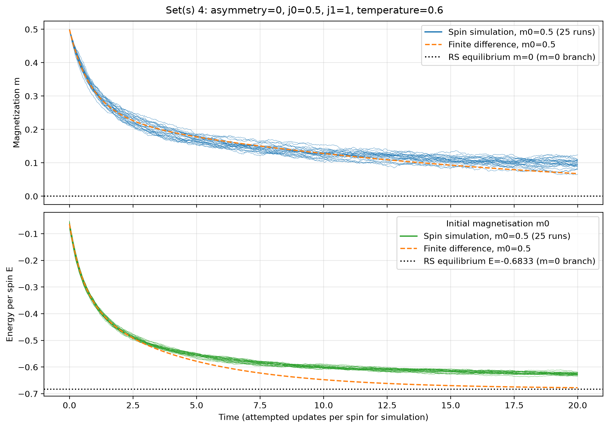
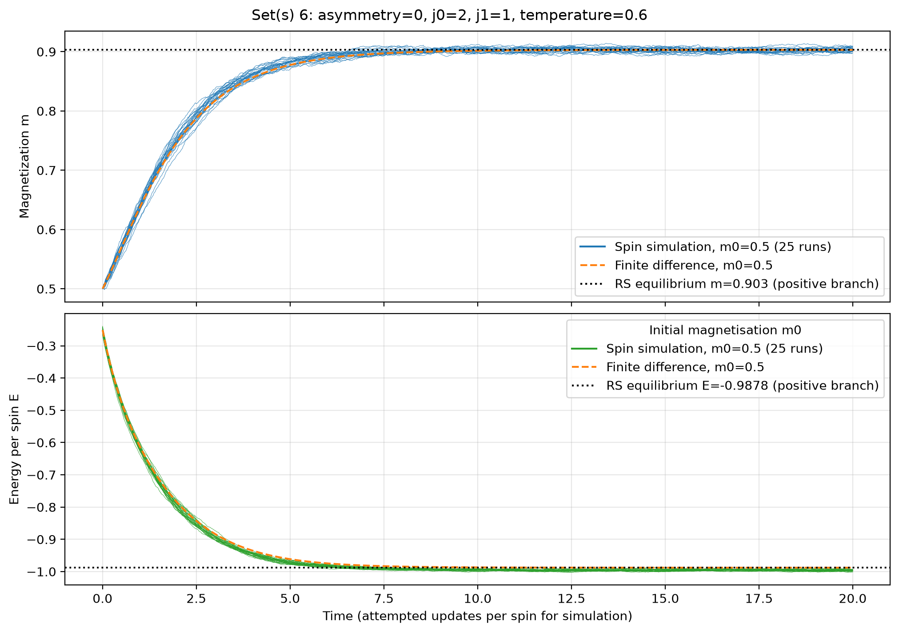
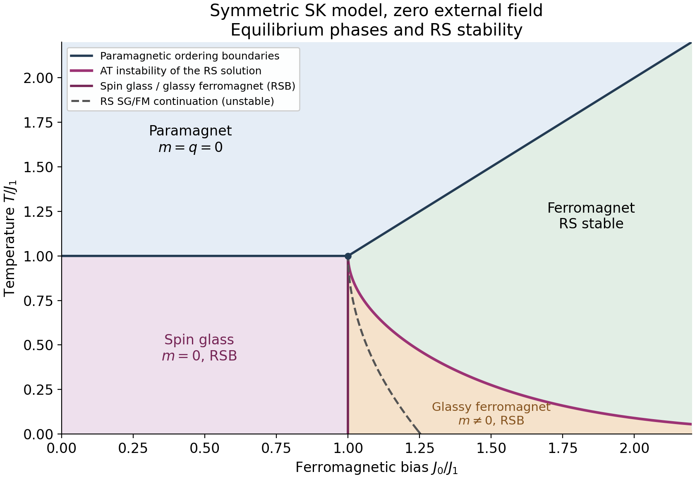

# Appendix D: experimental Python reconstruction

This is a **research prototype**, not a validated replacement for the 1995 C code.

It reconstructs the replica-symmetric auxiliary Gaussian-field measure and associated saddle equations, and replaces the finite-difference time update with a conservative exponentially fitted flux method. It uses log-sum-exp to prevent exponential overflow and refuses to conceal saddle nonconvergence.

A separate direct spin simulator reconstructed from `sk.c` and `ask.c` is also
available: see [Direct spin simulation](#direct-spin-simulation-the-original-skc-and-askc-models).
It shares the parameter-file and timestamped-output approach and the inspection notebook.

## Copyright and permissions

All rights reserved by the respective copyright holders. This repository is
published **without a licence**. No additional permission to reuse, modify or
redistribute its code, text or figures is granted.

This notice does not restrict rights provided by applicable law or the
[GitHub Terms of Service](https://docs.github.com/en/site-policy/github-terms/github-terms-of-service),
including viewing and forking public repositories on GitHub. Linked publications
remain subject to their own copyright and terms.

## Sample outputs

These examples compare the RS spin-field diffusion (orange dashed) with 25
direct spin simulations sharing one fixed coupling matrix (thin blue/green
curves), each with 10,000 spins. Both use symmetric couplings, $J_1=1$,
$T=0.6$, initial magnetisation $m_0=0.5$, and run to $t=20$ attempted updates
per spin. The dotted lines are **replica-symmetric equilibrium references**.

**Spin-glass region: $J_0=0.5$.** Magnetisation decreases while the energy
relaxes. The RS diffusion and simulations separate visibly at later times,
particularly in energy. This finite-time example does not establish the true
long-time limit; the RS equilibrium reference is unstable in this region and
is not the full Parisi equilibrium prediction.



**Ferromagnetic region: $J_0=2$.** Magnetisation grows towards about 0.903,
with close agreement between the diffusion and simulations over the plotted
interval. The diffusion energy approaches about -0.988; the simulations retain
a small offset for this finite, fixed disorder sample.



These are saved outputs from cases 4 and 6 of the 24 October 2026 sweep
`comparison_2026-10-24_143151_762575`. Both methods completed to $t=20$;
the diffusion archives identify the corrected Scharfetter–Gummel flux.
They use 128 field cells on [-10, 10], Gauss–Hermite order 64,
maximum time step 0.002 and saddle tolerance $2.5\times10^{-5}$.
The figures were produced with `compare_trajectories.ipynb`; their
[provenance](figures/examples/provenance.json) records the source archives and
settings. Full generated run archives remain local. The
[thesis](docs/SL_DPhil_Thesis_1995.pdf) is included in `docs/`; other papers are
listed with publisher or preprint links in the [references](docs/REFERENCES.md).

## The SK model, replicas and the implemented dynamics

### From the original SK solution to replica symmetry breaking

The [Sherrington-Kirkpatrick (SK) model](https://doi.org/10.1103/PhysRevLett.35.1792)
describes N Ising spins with frustrated, quenched (fixed during a run),
infinite-range random interactions. For symmetric couplings and zero external
field,

```math
\mathcal{H}(\boldsymbol{\sigma})=-\sum_{i \lt j}J_{ij}\sigma_i\sigma_j,\qquad J_{ij}=J_{ji}=\frac{J_0}{N}+\frac{J_1}{\sqrt{N}}z_{ij},\qquad \sigma_i=\pm1,\quad z_{ij}\sim\mathcal{N}(0,1).
```

Independent z values are drawn for unordered pairs; there is no self-interaction.
The code calls the mean bias `j0`, disorder scale `j1` and temperature
`temperature`, with Boltzmann's constant set to one. Its symmetric model is
`asymmetry = 0`; directed couplings at k>0 generally lack detailed balance and
are outside the equilibrium discussion below.

For one fixed coupling realization J, the **partition function** sums the
Boltzmann weights of all spin configurations:

$$
Z_N(J)=\sum_{\boldsymbol\sigma}e^{-\beta\mathcal H_J(\boldsymbol\sigma)},
\qquad p_J(\boldsymbol\sigma)=\frac{e^{-\beta\mathcal H_J(\boldsymbol\sigma)}}{Z_N(J)},
\qquad F_N(J)=-T\log Z_N(J),\quad \beta=1/T.
$$

Thus Z normalizes equilibrium probabilities, while its logarithm gives the
free energy and, through derivatives, thermodynamic observables. The Boltzmann
distribution describes thermal averaging at fixed disorder. A separate overbar averages over the
Gaussian couplings to describe typical samples. Since the couplings are frozen
while spins equilibrate, the relevant **quenched** quantity is
$f=\lim_{N\to\infty}\overline{F_N}/N$; for SK this free-energy density is
self-averaging in the thermodynamic limit. Averaging Z first would instead give
the **annealed** free energy $-T\log\overline{Z_N}$, which generally differs and
can be dominated by atypical disorder samples. The replica trick computes
moments of Z as a route to averaging **log Z**, not as a replacement for it.

For a positive integer n, $Z_N^n$ is the partition function of n independent
thermal copies with the **same** couplings. Averaging their shared disorder
couples the replicas mathematically. At finite N define

$$
M_N(n)=\overline{Z_N^n},\qquad
\overline{\log Z_N}
=\left.\partial_n\log M_N(n)\right|_{n=0}
=\lim_{n\to0}\frac{M_N(n)-1}{n}.
$$

Because $Z_N>0$, $Z_N^n=e^{n\log Z_N}$ also makes sense for real n; the problem
is evaluating its disorder average. The replica representation by n spin copies
is directly available only at integer n. A formula obtained there must be
continued to real n near zero. Integer values alone do not uniquely determine
an analytic continuation, so this step requires more than substituting n=0
into an arbitrary integer-n expression.

The **order of limits** is a second issue. Setting
$\psi_N(n)=N^{-1}\log M_N(n)$, the finite-N identity specifies

$$
f=-T\lim_{N\to\infty}\lim_{n\to0}\frac{\psi_N(n)}{n}.
$$

In the usual replica calculation one evaluates the large-N saddle at fixed
positive integer n first, continues the resulting expression, and then takes
n to zero: $-T\lim_{n\to0}\lim_{N\to\infty}\psi_N(n)/n$. Interchanging these
limits is not justified by the finite-N identity alone: expansions in n need
not be uniform in N, and the dominant saddle can change. The logarithmic moment
form is essential when taking N first; directly reversing the limits in
$(M_N(n)-1)/(nN)$ generally diverges. For Gaussian SK, commutation can be
justified for the properly defined real-n moment pressure; see
[Barra, Guerra and Mingione (2012)](https://doi.org/10.1080/14786435.2011.637979).
That result does not automatically validate a chosen continuation of the
integer-n saddle or the low-temperature RS ansatz.

For integer n, disorder averaging introduces the overlap matrix
$q_{ab}=N^{-1}\sum_i\sigma_i^a\sigma_i^b$, with $q_{aa}=1$, into the saddle
problem. **Continuing this calculation does not mean constructing a literal
noninteger-dimensional matrix.** One chooses a structure for the integer-n
matrices, evaluates the replica sums and saddle functional in terms of its
parameters and n, and continues those expressions. For example, RS sets every
off-diagonal overlap to q, and its unordered-pair multiplicity is n(n-1)/2.
Parisi's hierarchy allows a richer structure before continuation. Choosing
the appropriate saddle structure matters as well as taking the limits.

The original RS calculation gives the following self-consistency equations,
with $Dz=e^{-z^2/2}dz/\sqrt{2\pi}$:

$$
m=\int Dz\,\tanh[\beta(J_0m+J_1\sqrt q\,z)],
\qquad q=\int Dz\,\tanh^2[\beta(J_0m+J_1\sqrt q\,z)].
$$

Here m measures uniform magnetization; q measures frozen local order within
RS. Spontaneous m refers to a selected symmetry-broken branch in the
thermodynamic limit. The paramagnet has m=q=0; the RS spin-glass branch has
m=0, q>0; the ferromagnetic branch has m nonzero. These equations supply the
notebooks' RS references, including
$e_{\rm RS}=-[J_0m^2+\beta J_1^2(1-q^2)]/2$.

[De Almeida and Thouless](https://doi.org/10.1088/0305-4470/11/5/028)
showed that RS loses stability to overlap fluctuations (the replicon mode).
With $u=\beta(J_0m+J_1\sqrt q\,z)$, the stability condition is

$$
\lambda_{\rm AT}=1-(\beta J_1)^2\int Dz\,\frac{1}{\cosh^4 u}\geq0.
$$

Its zero defines the AT boundary; a negative value means the RS saddle is
unstable, even if its self-consistency equations have been solved accurately.
For J0=0 at zero field, instability begins below T=J1.
[Parisi's solution](https://doi.org/10.1103/PhysRevLett.43.1754) replaces the single
overlap by a hierarchy, represented in the full replica-symmetry-breaking (RSB)
limit by a function q(x), $0\leq x\leq1$. It describes the distribution of
overlaps between equilibrium states; glassy order can coexist with nonzero
magnetization. **This program implements RS dynamics, not full Parisi RSB.**

### Phase diagram and the limits of RS



The paramagnetic ordering boundaries are T=J1 for J0<J1 and T=J0 for J0>J1.
The vertical boundary from (1,1) to (1,0), in units (J0/J1,T/J1), separates the
**spin glass** (purple, m=0 with RSB) from the **glassy ferromagnet**, also called
the mixed phase (orange, nonzero m with RSB). The latter lies between this
vertical line and the AT curve. On the ferromagnetic side of the AT curve,
RS is stable (green). Both kinds of ferromagnet have nonzero local overlap;
RSB, rather than q>0 alone, distinguishes their glassy character. See the
[equilibrium phase-diagram discussion](https://academic.oup.com/book/8876/chapter/155122901).

Three different boundaries must not be confused:

- The **vertical SG/mixed boundary** is the full-RSB equilibrium result at
  J0/J1=1 below T/J1=1. It is included as a known result; this plotting script
  does not solve the Parisi equations.
- The **dashed original SK/RS SG/FM boundary** is the spurious re-entrant
  transition. It ends at $(J_0/J_1,T/J_1)=(\sqrt{\pi/2},0)\simeq(1.2533,0)$.
  It lies inside the RS-unstable region and does not delimit the physical
  glassy-ferromagnetic phase.
- The **AT line** bounds RS stability and lies to the right of the dashed
  curve. It does not end at (1.25,0): for Gaussian SK couplings its critical
  bias grows without bound as T tends to zero. In the low-temperature,
  large-bias limit, [de Almeida and Thouless (1978), equation (20)](https://chimera.roma1.infn.it/ENZO/SISDIS/PAPERS/dat.pdf)
  give $T_{\rm AT}/J_1\sim\frac{4}{3\sqrt{2\pi}}
  \exp[-(J_0/J_1)^2/2]$. The AT condition is an equilibrium stability test,
  not a dynamical relaxation rate.

The AT and dashed RS curves are computed down to T/J1=0.02; the latter is
joined to its analytic zero-temperature endpoint. Reproduce the figure with
`python python/plot_sk_phase_diagram.py` after installing
`requirements-notebook.txt`; the accompanying `Output/sk_rs_phase_boundaries.csv` records the computed boundaries.
The generator saves the PNG to `figures/sk_rs_phase_diagram.png`, resolving
both destinations from its project location rather than the working directory.

### From Glauber spin flips to the spin-field diffusion equation

**Microscopic master equation.** Let $F_i\boldsymbol\sigma$ denote the
configuration with spin i reversed. With local fields
$h_i=\sum_{j\ne i}J_{ij}\sigma_j$ and heat-bath rates
$w_i(\boldsymbol\sigma)=\tfrac12[1-\sigma_i\tanh(\beta h_i)]$, the probability
of a configuration obeys

$$
\partial_t p_t(\boldsymbol\sigma)=\sum_i
\left[w_i(F_i\boldsymbol\sigma)p_t(F_i\boldsymbol\sigma)
-w_i(\boldsymbol\sigma)p_t(\boldsymbol\sigma)\right].
$$

The gain and loss terms describe individual spin flips. Solving this directly
requires following $2^N$ configuration probabilities.

**Macroscopic projection and Taylor expansion.** Following thesis section 1.4,
choose c observables $\boldsymbol\Omega(\boldsymbol\sigma)$ and define their
probability distribution and their changes under a flip:

$$
P_t(\boldsymbol\Omega)=\sum_{\boldsymbol\sigma}p_t(\boldsymbol\sigma)
\delta(\boldsymbol\Omega-\boldsymbol\Omega(\boldsymbol\sigma)),
\qquad \Delta_i^\mu(\boldsymbol\sigma)
=\Omega_\mu(F_i\boldsymbol\sigma)-\Omega_\mu(\boldsymbol\sigma).
$$

Projecting the master equation onto these observables replaces each gain term
by a shifted delta function. Taylor expansion in the jumps $\Delta_i^\mu$
gives the Kramers-Moyal expansion (1.13), whose first two terms are

$$
\begin{aligned}
\partial_tP_t&=-\sum_\mu\partial_{\Omega_\mu}(P_t A_\mu)
+\frac12\sum_{\mu\nu}\partial_{\Omega_\mu}\partial_{\Omega_\nu}(P_t B_{\mu\nu})
+\cdots,\\
A_\mu(\boldsymbol\Omega,t)&=\left\langle\sum_i w_i\Delta_i^\mu\right\rangle_{\boldsymbol\Omega,t},
\qquad B_{\mu\nu}(\boldsymbol\Omega,t)
=\left\langle\sum_i w_i\Delta_i^\mu\Delta_i^\nu\right\rangle_{\boldsymbol\Omega,t}.
\end{aligned}
$$

The brackets denote the microscopic distribution **conditioned on the current
macroscopic shell**, not an equilibrium thermal average:

$$
\langle g\rangle_{\boldsymbol\Omega,t}
=\frac{\sum_{\boldsymbol\sigma}p_t(\boldsymbol\sigma)
\delta(\boldsymbol\Omega-\boldsymbol\Omega(\boldsymbol\sigma))g(\boldsymbol\sigma)}
{\sum_{\boldsymbol\sigma}p_t(\boldsymbol\sigma)
\delta(\boldsymbol\Omega-\boldsymbol\Omega(\boldsymbol\sigma))}.
$$

Under the small-jump scaling conditions of section 1.4.1, the second and higher
macroscopic Kramers-Moyal terms vanish as N tends to infinity. For example,
fixed-c intensive averages with jumps of order 1/N have finite drift and
fluctuation coefficients B of order 1/N. The remaining equation is Liouville
transport; its characteristics obey $\dot\Omega_\mu=A_\mu(\boldsymbol\Omega,t)$
(1.14). A macroscopically sharp initial state therefore follows a deterministic
trajectory; a broad initial distribution is transported along such trajectories.

**Removing explicit microscopic time dependence is a closure assumption.**
The drift still contains $p_t(\boldsymbol\sigma)$ through the shell average.
Deterministic evolution alone has not closed the problem. Section 1.4.3 gives
two ways to eliminate this dependence: the microscopic generator
$\sum_iw_i\Delta_i^\mu$ may already be a function of the chosen observables
alone, giving exact closure; alternatively, one assumes equipartition of
probability among configurations within each shell. Under the latter assumption,
the unknown microscopic weights cancel:

$$
\langle g\rangle_{\boldsymbol\Omega,t}\quad\longrightarrow\quad
\frac{\sum_{\boldsymbol\sigma}
\delta(\boldsymbol\Omega-\boldsymbol\Omega(\boldsymbol\sigma))g(\boldsymbol\sigma)}
{\sum_{\boldsymbol\sigma}
\delta(\boldsymbol\Omega-\boldsymbol\Omega(\boldsymbol\sigma))}.
$$

This replacement is not guaranteed by taking N large, nor by equipartition in
the initial state. It discards microscopic history not specified by the chosen
observables. For constant physical parameters the resulting law is autonomous,
$\dot{\boldsymbol\Omega}=\boldsymbol A(\boldsymbol\Omega)$: coefficients still
change with the evolving state, but no longer require an independently known
$p_t$. It does **not** mean setting time derivatives to zero or freezing the
coefficients at equilibrium. Chapter 6 also assumes self-averaging of the flow
over the quenched disorder, a distinct assumption from shell equipartition.

**Choosing the spin-field density.** Chapter 6 uses the joint density itself
as the macroscopic order parameter, retaining more information than m and e alone:

$$
\rho_t^\sigma(h)=\frac1N\sum_i\delta_{\sigma,\sigma_i(t)}\delta(h-h_i(t)),
\qquad m_t=\sum_\sigma\sigma\int dh\,\rho_t^\sigma(h),
\qquad e_t=-\frac12\sum_\sigma\sigma\int dh\,h\rho_t^\sigma(h).
$$

A finite collection of field samples is considered first. Section 6.2 requires
c much smaller than $\sqrt N$ and a sufficiently smooth density, with no field
derivatives growing with N; the continuum field resolution is taken after the
thermodynamic limit. There is then a **second Taylor expansion**, distinct from
the macroscopic Kramers-Moyal expansion above. Flipping spin i changes its own
spin label and shifts every other field by $-2J_{ji}\sigma_i$. Expanding the
field delta functions gives, with $x=h-h_j$,

$$
\delta(x+2J_{ji}\sigma_i)
=\delta(x)+2J_{ji}\sigma_i\delta'(x)+2J_{ji}^2\delta''(x)+\cdots.
$$

After summing the flip contributions and taking the thermodynamic limit, the
first- and second-order field-shift terms yield drift and diffusion in h,
while the spin-label change gives the explicit gain/loss terms. Thus diffusion
of probability **along the local-field axis** survives even though stochastic
fluctuations of the **macroscopic density trajectory** vanish. A replica
calculation evaluates the closed shell averages; imposing RS gives the
instantaneous saddle equations (6.15) and the flow (6.16)-(6.17):

$$
\begin{aligned}
\partial_t\rho_t^\sigma(h)={}&
\tfrac12[1+\sigma\tanh(\beta h)]\rho_t^{-\sigma}(h)
-\tfrac12[1-\sigma\tanh(\beta h)]\rho_t^\sigma(h)\\
&+\partial_h\!\left[\rho_t^\sigma(h)
\{(h-J_0m_t)\Phi_1(t)+\Phi_2^\sigma(t)\}+\Phi_3^\sigma(h,t)\right]
+\Phi_4(t)\partial_h^2\rho_t^\sigma(h).
\end{aligned}
$$

**Explicit RS coefficients.** The following is equation (6.17), using
J0 and J1 for the thesis's tilded couplings and suppressing time arguments.
Define

$$
X=H-J_0m,\qquad \tau(H)=\tanh(\beta H),\qquad
\kappa=\frac{1-k^2}{1+k^2},\qquad
\ell_0=\frac{1-2q}{J_1^2(1-q)^2},\qquad
\ell_1=\frac{q}{J_1^2(1-q)^2}.
$$

Here q, R0 and R1 belong to the instantaneous RS saddle (6.15), with
$R_0=\texttt{theta0}$ and $R_1=\texttt{theta1}$ in Python. The symbols
$\ell_0,\ell_1$ denote the thesis's $\lambda_0^2,\lambda_1^2$;
$\ell_0$ is an algebraic coefficient and can be negative, not a variance.
This representation requires q<1. At T=0, use $\tau(H)=\mathrm{sgn}(H)$,
with $\mathrm{sgn}(0)=0$.

At fixed independent standard Gaussian variables w,y, let $\langle f\rangle_M$ denote
the normalized spin-field average under the RS measure M of (6.15):

$$
\langle f\rangle_M(w,y)
=\frac{\sum_{s=\pm1}\int dH\,f(s,H)M(H,s;w,y)}
{\sum_{s=\pm1}\int dH\,M(H,s;w,y)},\qquad
\mathcal G[g]=\int Dw\,Dy\,g(w,y).
$$

The inner spin s is distinct from the external density label sigma. In
particular, $\rho^\sigma(h\mid w,y)=\langle\delta_{\sigma,s}\delta(h-H)\rangle_M$
and $\rho^\sigma(h)=\mathcal G[\rho^\sigma(h\mid w,y)]$. For readability,
write the five scalar moments and two density-weighted moments as

$$
\begin{aligned}
\mathcal U&=\mathcal G[\langle\tau\rangle_M],&
\mathcal A&=\mathcal G[\langle s\tau\rangle_M],&
\mathcal B&=\mathcal G[\langle s\rangle_M\langle\tau\rangle_M],\\
\mathcal C&=\mathcal G[\langle X\tau\rangle_M],&
\mathcal D&=\mathcal G[\langle X\rangle_M\langle\tau\rangle_M],\\
S^\sigma(h)&=\mathcal G[\rho^\sigma(h\mid w,y)\langle s\rangle_M],&
K^\sigma(h)&=\mathcal G[\rho^\sigma(h\mid w,y)\langle X\rangle_M].
\end{aligned}
$$

Products inside $\mathcal G$ share the same Gaussian variables; they are
not products of separately Gaussian-averaged quantities. The coefficients are

$$
\Phi_1=1-J_1^2\ell_0\mathcal A-J_1^2\ell_1\mathcal B,
$$

$$
\begin{aligned}
\Phi_2^\sigma={}&J_0(m-\mathcal U)
-\sigma J_1^2\kappa(\ell_0\mathcal C+\ell_1\mathcal D)\\
&+2\sigma J_1^2\kappa[(R_0+R_1)\mathcal A-R_1\mathcal B],
\end{aligned}
$$

$$
\begin{aligned}
\Phi_3^\sigma(h)={}&J_1^2\kappa S^\sigma(h)
[(\ell_0+2\ell_1)\mathcal D-\ell_1\mathcal C]\\
&+J_1^2K^\sigma(h)[(\ell_0+2\ell_1)\mathcal B-\ell_1\mathcal A]\\
&-2J_1^2\kappa S^\sigma(h)[(R_0-R_1)\mathcal B+R_1\mathcal A],
\end{aligned}
$$

$$
\Phi_4=J_1^2(1-\mathcal A).
$$

In `coefficients`, these moments correspond to `tp+tm`, `tp-tm`, `ts`, `ht`,
`h_t`, `sol['sr']` and `sol['hr']`, respectively. Only Phi3 depends explicitly
on h; Phi2 also carries a spin label. In particular, the middle term of Phi3
has **no kappa factor**, so Phi3 does not generally vanish at k=1.
Since $\mathcal A=\sum_s\int dH\,s\tau(H)\rho^s(H)$, the diffusion coefficient
is nonnegative. These are the continuum coefficients at a matched saddle;
the fitted-density normalization of numerical Phi3 at finite saddle tolerance
is described under [strong-coupling stability](#stability-of-low-temperature-strong-mean-coupling-runs).

The coefficients depend on the current density through the RS saddle solved
at every step: this is a nonlinear self-consistent equation, not diffusion
with prescribed coefficients. The implementation uses exponentially fitted
field transport and exact spin-flip substeps. Symmetric-model RS equilibrium
solutions are fixed points of this closure; that does not establish general
long-time exactness or stability against RSB. See
[the thesis](docs/SL_DPhil_Thesis_1995.pdf), sections 1.4 and 6.2-6.5, and
[Coolen, Laughton and Sherrington (1996)](https://doi.org/10.1103/PhysRevB.53.8184)
for the dynamical derivation. This introduction uses LaTeX math inside Markdown;
equation display requires a Markdown viewer with math support.

## Reading the Python source

Both main scripts include an in-file reading guide, array conventions and
explanations of the numerical stages. Short block comments also explain routine
setup and housekeeping: command-line parsing, file/option precedence, validation,
progress messages, unique filenames and archive writing. In [python/spinglass.py](python/spinglass.py),
follow `initial` -> `saddle` -> `coefficients` -> `advance` inside `run`; the
comments explain the RS measure, fitted variables, independent equation checks,
exponential-fit transport and pre-/post-update diagnostic times. In
[python/simulate_spinglass.py](python/simulate_spinglass.py), follow coupling and
spin initialization -> `run` -> `run_ensemble` -> archive output; comments cover
matrix orientation, cached fields, random streams, attempt-based time and the
distinction between a fixed-disorder ensemble and disorder averaging.
The expanded source explanations do not change the algorithms, settings or
output formats.

## Install and run

Run commands and notebooks from the project root. Application Python files are
in `python/`, the three editable run-parameter files are in `config/`, and
the original C programs are in `C/`. Tests and their regression fixtures remain
in `tests/`; the thesis and reference list are in `docs/`. Other reference PDFs
may be kept there locally and are excluded from version control. The notebooks stay at the
root and add `python/` to their import path in the first code cell.
After this directory reorganisation, restart any existing notebook kernel and
rerun its cells from the top so it uses the relocated modules and config paths.
Dependency files `requirements.txt` and `requirements-notebook.txt` remain at
the root. Relative output paths in parameter files still resolve from the
working directory, not from `config/`; run archives continue to use `Output/`.

```bash
python -m pip install -r requirements.txt
python python/spinglass.py config/parameters.txt
```

The included `config/parameters.txt` is an example input file. Settings use `name = value`,
one per line. Blank lines and comments beginning with `#` are allowed, including
comments after a value:

```text
temperature = 1.5
m0 = 0.2             # initial magnetization
t_end = 0.01
cells = 24
gaussian_order = 8   # Gauss-Hermite quadrature order
output = Output/trajectory.npz
```

Omitted settings use the following command-line run defaults. Integer settings
must be written as integers (for example, `cells = 32`, not `32.0`). Unknown names,
duplicate settings, nonnumeric numerical settings and nonfinite values are rejected.
The `output` setting is an unquoted filename or path; spaces are allowed, and `#`
starts a comment. Relative output paths are relative to the directory from which
you run the program. Each run appends its local start date and time, including
seconds and microseconds, before the `.npz` extension. For example, either
`output = output` or `output = output.npz` produces a name such as
`output_2026-10-18_231112_345678.npz`. The program prints the actual saved path.
Existing files are never overwritten: a numeric suffix is added if a timestamp
collides with an existing filename.

To save runs in the project's existing `Output` folder, set:

```text
output = Output/output.npz
```

Run `python python/spinglass.py config/parameters.txt` from the project directory. This saves
files such as `Output/output_2026-10-18_231112_345678.npz`. The destination folder
must already exist; the program does not create it. If you run from another
directory, use an absolute output path or adjust the relative path accordingly.

| Parameter | Default | Meaning |
| --- | --- | --- |
| `j0` | `0.0` | Mean coupling |
| `j1` | `1.0` | Coupling scale |
| `temperature` | `1.5` | Temperature |
| `asymmetry` | `0.0` | Thesis equation (1.18) mixing k, **0 <= k <= 1** |
| `hmin` | `-6.0` | Lower field boundary |
| `hmax` | `6.0` | Upper field boundary |
| `cells` | `32` | Number of field cells |
| `gaussian_order` | `8` | Gaussian quadrature order |
| `saddle_tol` | `2e-5` | Maximum absolute dimensionless equation residual |
| `saddle_maxiter` | `120` | Maximum least-squares objective evaluations per saddle |
| `saddle_damping` | `0.12` | Legacy input accepted and recorded; inactive in the new solver |
| `dt_max` | `0.002` | Maximum timestep |
| `t_end` | `0.01` | End time |
| `m0` | `0.2` | Initial magnetization |
| `output` | `trajectory.npz` | Output file containing all results and parameters |

Existing command-line options still work. Explicit command-line values override
the file; for example, this uses the file but changes temperature and quadrature:

```bash
python python/spinglass.py --config config/parameters.txt --temperature 2.0 --quadrature 12
```

Use `gaussian_order` in the file and `--quadrature` on the command line. You can
override the file's output path with `--output another_run.npz`. The original
`--config config/parameters.txt` form also works; use either that or the positional file,
not both. For the full command-line help, run `python python/spinglass.py --help`.
Running without a config file preserves the existing defaults and usage:

```bash
python python/spinglass.py --temperature 1.5 --m0 0.2 --t-end 0.01 --cells 32 --quadrature 8
python -m pytest -q
```

The reference high-temperature run (`temperature = 1.5`, `m0 = 0.2`,
`t_end = 20.01`, 24 cells) has been checked at quadrature orders 8 and 12.
Both complete with every accepted
saddle satisfying all equation checks. These are numerical checks, not a
reproduction of the thesis figures. See the
[consolidated saddle-solver history](NUMERICAL_INVESTIGATIONS.md#2-coupled-saddle-solver-and-initial-validation)
for the method, residual definitions, and historical short- and long-run results.

## Saddle solver and convergence

The solver uses the replica-symmetric equations (6.15) in Chapter 6, section 6.4.1.
It solves the coupled density, overlap and multiplier equations using bounded
least squares. A Gaussian covariance factorization remains well-defined at the
initial `r = 0` state and keeps trial covariances positive semidefinite. It does
not use the original C code's negative-square-root fallbacks.

Weights are retained internally as `logchi` throughout the calculation. Converting
small weights to linear form and back would lose them to underflow, producing
infinite optimizer inputs in low-temperature runs. Before an optimization, a
sequence of four log-domain density-matching updates refreshes the initial logweights at fixed
covariance so tiny predicted probabilities do not create flat optimizer columns.
This is an initial-guess calculation, with no probability floor or clipping;
the equations and acceptance tolerance are unchanged. The saved solver method
`bounded_least_squares_RS_v3` identifies this numerical-state correction.
Optimization stops as soon as a candidate passes every independent equation
check at `saddle_tol`, rather than continuing toward tighter internal optimizer
thresholds. This uses the same criterion as warm-start acceptance and avoids
oversolving weak tail directions. It can change trajectories relative to earlier
versions that optimized further; a per-solve tolerance does not bound accumulated
trajectory error. Include `saddle_tol` refinement in numerical accuracy studies.

The least-squares objective includes the original scalar equations evaluated
with the candidate measure's moments, as well as every density cell. This avoids
the earlier mismatch between optimizing equations with target moments substituted
and checking the original equations at a finite-error fit.

Before accepting a saddle it independently recomputes **all** equations: density,
magnetization, `mu`, `q`, `Theta0`, `Theta1`, and `Q0 = r²`, together with conditional
normalization and covariance admissibility. All dimensionless residual magnitudes
must be at most `saddle_tol`; an optimizer success flag alone cannot accept a fit.
Failures identify the simulation time, step, worst equation, and residuals, and do
not replace the last verified saddle state. Failure messages also report the
conditional Gaussian variance and optimizer termination reason; reaching a
stationary bounded fit does not guarantee a root.

`saddle_maxiter` limits objective evaluations (Jacobian evaluations are additional).
The legacy `saddle_damping` setting remains accepted and recorded for input-file
compatibility, but has no effect on the least-squares solver; the saved `solver`
record identifies it as inactive. Fully polarized states (`|m| = 1`, requiring
`q = 1`) are singular in this representation and are explicitly rejected when a
saddle is requested.

Quadrature must resolve the chosen state. For example, `m0 = 0.6` with order 4
fails the full `Q0` check even initially; orders 8 and 12 complete the tested
`t_end = 0.01` run (including at zero temperature). Increase quadrature and check
convergence rather than loosening the equation checks merely to obtain a run.
For the longer `t_end = 20.01`, `m0 = 0.2` run, order 4 still fails at a bounded
fit near `t = 6.682`; orders 8 and 12 complete with the unchanged tolerance.
Order 8 is the current example setting and was already the command-line default.
Their final recorded q values differ by about 0.14%, so completion alone should
not be interpreted as full quadrature convergence.

Low-temperature trajectories can require substantially higher quadrature order.
The reported `temperature = 0.01`, `m0 = 0.3` case exposed a linear-weight
underflow bug at `t = 2.466`; persistent logweights and density-based optimizer
initialization fix that numerical-state issue. With the checks retained, the
order-8 run later fails around `t = 5.43`, and order 12 around `t = 6.98`.
These later failures must not be hidden by relaxing `saddle_tol`. See the
low-temperature validation notes for higher-order full-run checks and limits.
For this specific `t_end = 10.01` run, orders 24 and 32 have both been checked to
complete without numerical warnings, preserving mass, positivity, and all saddle
checks. Their final recorded q differs by about 1.1%, so further quadrature and
other refinement is required before interpreting the result physically.

## Saved results and parameter record

Command-line runs print a start message, progress updates about every 10 seconds
of elapsed wall-clock time, and a completion message before saving. Updates show
the current simulation time and target, percentage of simulated time completed,
completed step count, and elapsed seconds. During a saddle solve they also show
the current step, saddle objective-evaluation count, and maximum equation residual. Messages are flushed immediately
so they remain visible when output is redirected. Updates occur at step boundaries
and objective evaluations; an individual expensive calculation can delay an update.
Short runs may finish before a periodic update is due. The percentage describes
simulation time, not an estimate of wall-clock completion time.

Direct Python calls to `SpinGlass.run()` remain quiet by default; pass
`progress_interval=10.0` to enable the same reporting.

If a finite-difference saddle solve fails, the program saves a timestamped NPZ
containing all completed trajectory steps, their energy and saddle diagnostics,
and the last valid density. It then reports the error and exits unsuccessfully;
no failed saddle is accepted. The `parameters` JSON includes `run_status`
(`complete` or `failed`), `completed_time`, and `failure_message`. If the first
saddle fails, the archive contains the initial density and empty trajectory arrays.
This handles saddle exceptions, not forced process termination or power loss;
these files are results for inspection, not restart checkpoints.

The NumPy `.npz` output contains `trajectory`, `rho`, `h`, `energy`, and `parameters`, plus
`saddle_residuals`, `saddle_residual_names`, `saddle_times`, and `solver`.
The trajectory columns remain time, magnetization, `q`, mass, and residual.
`energy` is a separate array aligned with the trajectory times, computed after
each density update. Following Appendix D, energy per spin is
`E = -0.5 * dh * sum(h * (rho_plus - rho_minus))`, using the full field `h`.
For new files, **residual** is the maximum absolute dimensionless residual over
all equations; older files stored only the density RMS error. The `solver` JSON
record distinguishes the new method. Each row of `saddle_residuals` gives the
individual signed residuals (density/normalization/covariance use nonnegative
norms) in the order of `saddle_residual_names`. `saddle_times` gives their actual
simulation times, before the corresponding density update. The final evolved
density is saved without an additional final-time saddle solve.
`parameters` is a JSON string recording every effective solver setting, `m0`,
and `t_end`, including defaults and command-line overrides. It also records the
config path, configured output name (`output`), actual saved path (`output_file`),
and start time with timezone offset (`run_started`). It retains `quadrature` as an alias for
`gaussian_order` for compatibility with earlier output metadata. The parameter
record is self-contained; reading it does not require the original input file.

```python
import json
import numpy as np

# Replace this example with the saved filename printed by the program.
with np.load('trajectory_2026-10-18_231112_345678.npz', allow_pickle=False) as data:
    parameters = json.loads(data['parameters'].item())
    trajectory = data['trajectory']
print(parameters)
```

## Inspect and plot a saved run

Install the optional notebook dependencies and open the notebook from the project
directory:

```bash
python -m pip install -r requirements-notebook.txt
python -m jupyterlab inspect_trajectory.ipynb
```

Run the cells in order. The notebook lists `.npz` files in `Output` and selects the
most recently modified file by default. Set `filename` in the first code cell to
inspect a specific file, then rerun the cells. It displays saved parameters, array
shapes, and the first ten trajectory rows and field/density cells, then plots
magnetization, recorded saddle `q`, and energy per spin `E` against simulation
time using Matplotlib. Older files lack energy history: the energy panel shows
only the final energy computed from the saved density. Rerun the solver to
obtain a full energy trajectory; it cannot be reconstructed from m and q alone.
Single-step runs have visible markers; zero-step runs display a message instead
of a plot. Saved data is not modified.

The recorded `q` and residual come from the saddle solve before each density
update; the row's time, magnetization and mass describe the updated density.

## Spatial flux and equilibrium preservation

Field transport uses a Scharfetter-Gummel (exponentially fitted) flux, followed by
the existing exact two-state spin-flip update. For face velocity `v`, diffusion
`D = Phi4` and cell width `dh`, the flux is
`D/dh * [B(-P)*rho_left - B(P)*rho_right]`, where `P = v*dh/D` and
`B(x) = x/(exp(x)-1)`. The face velocity still averages the adjacent cell
velocities, including the existing conditional `Phi3/rho` term. The formula solves
the local constant-coefficient transport problem; it does not prescribe a target
energy or replace the physical diffusion coefficient.

Evaluation uses a small-argument series and nonpositive exponentials to avoid
cancellation and overflow. At `D = 0` it reduces to pure upwind advection without
division by zero. Boundary fluxes remain zero. An explicit transport step is
limited by `dt <= 0.8 / max_outgoing_rate`, as well as `dt_max` and the remaining
run time; this bounds the sum of outgoing contributions at each cell and preserves
nonnegative density. No new configuration settings are needed. New archives
identify the method in the `solver` JSON with
`spatial_flux = scharfetter_gummel_v1` and
`transport_timestep = 0.8_over_max_outgoing_rate`. Older archives lack these keys
and retain their original trajectories.

The previous separate upwind-drift/central-diffusion flux introduced artificial
diffusion and failed to preserve a known SK equilibrium, even with an exact
saddle. For `j0=0.75`, `T=1.5`, `j1=1`, `k=0`, the equilibrium is `m=q=0`,
`E=-1/3`. At 128 cells over `[-8,8]`, the old flux instead settled near
`E=-0.36513`. The energy formula itself was correct. Refining the old grid to
256 cells moved the result to approximately `-0.34919`; reducing the timestep
did not remove the spatial bias.

Regression tests now advance the analytic high-temperature equilibrium density,
rather than checking only its saddle and coefficients. The exponentially fitted
flux preserves this Gaussian equilibrium to floating-point accuracy on the tested
grids, including a non-unit coupling scale. Tests also cover local zero-current
balance, mass, positivity, vanishing drift, zero diffusion and large Peclet numbers.
This exact equilibrium preservation is specific to the tested Gaussian case;
general self-consistent, non-Gaussian equilibria still require grid, domain,
quadrature, timestep and saddle-tolerance convergence checks. The saddle closure,
energy formula, simulator and equilibrium reference calculation are unchanged.

Full self-consistent runs at these physical settings, starting from `m0=0` and
using `saddle_tol=1e-9`, reach energies `-0.3333333318`, `-0.3333333320` and
`-0.3333333321` by `t=30` on 64, 128 and 256 cells respectively. They preserve
mass and nonnegative density and pass every saddle check. See
[field-transport validation](NUMERICAL_INVESTIGATIONS.md#7-equilibrium-preserving-field-transport-23-october-2026) for settings, before/after comparisons,
regression coverage and the recorded stricter-tolerance saddle failure. These
checks do not replace a rerun of the original 150-time-unit, order-64 sweep.

## Important limitations

- **Not scientifically validated** against the thesis figures or microscopic Monte Carlo. The original external headers are absent.
- The quadrature, finite field domain and grid introduce approximation errors.
  Passing all discretized saddle equations is necessary, but does not establish
  convergence to the continuous equations or stability against replica symmetry
  breaking. Perform quadrature, grid, domain, and timestep refinement checks.
- Least squares can fail to find an acceptable solution, particularly in poorly
  resolved or difficult states. Failure does not prove that no physical saddle exists.
- The covariance factorization rotates the two Gaussian integration variables.
  It represents the same continuous Gaussian integral, but finite-order results
  can differ from the previous orientation. Tests compare both at high order.
- [NUMERICAL_INVESTIGATIONS.md](NUMERICAL_INVESTIGATIONS.md) records the earlier
  fixed-point solver's failure, comparison with Appendix D, its replacement,
  subsequent improvements and the spatial-flux correction.
- The finite-volume flux interprets `Phi3 / rho` as an effective advection velocity. Conditional transport moments are normalized by their own fitted saddle density before being applied to the evolving density; the existing near-zero density floor remains. This is a numerical approximation that must undergo convergence testing.
- The density grid uses cell centres rather than the thesis's endpoint grid; results are not bitwise comparable.
- The program may be computationally expensive: each timestep requires solving a nonlinear replica saddle.

## Bug fixes and improvements relative to the original C code

The current Python program retains the Chapter 6 replica-symmetric equations,
but substantially changes their numerical solution and the checks required before
advancing a trajectory. Those changes can materially affect energies, overlaps,
relaxation curves and whether a run completes. It is not a line-by-line port or
a bitwise reproduction of Appendix D.

The distinctions below are important: a defect visible in the printed C source,
a deliberate replacement of its numerical method, and a bug in an earlier Python
reconstruction are different claims. In particular, the recently corrected
high-temperature energy bias was demonstrated in the **earlier Python upwind
flux**, not in an executed version of the original C program.

### Corrections and numerical replacements relative to Appendix D

| Area | Printed C implementation | Current Python implementation and significance |
| --- | --- | --- |
| Field boundaries | The upper minus-spin first derivative appears to omit parentheses around the density difference (printed p. 147). Boundary stencils also differ from the interior. | Both ends use zero probability flux. This avoids the apparent asymmetric derivative error and conserves mass, but is a deliberate boundary-condition choice, not merely a transcription repair. Results still need a sufficiently wide field domain. |
| Density evolution | Explicit finite differences can produce negative density; the C code clips it to zero and renormalizes after each update (pp. 146-147). | Conservative exponentially fitted transport with a bound on total outgoing rates preserves nonnegative density, followed by exact spin-flip evolution at fixed field. The evolved density is checked rather than clipped or renormalized. Clipping and renormalization can otherwise change spin-field correlations and energy while hiding an unstable update. |
| Time step | The printed step is proportional to `dh**2/Phi4`, without a separate drift bound; it divides by zero when `Phi4=0`. | The step obeys `dt_max`, remaining run time and the transport outgoing-rate bound. The flux has a defined pure-advection limit at zero diffusion. This handles drift-dominated and vanishing-diffusion states without using density clipping as a stability mechanism. |
| Saddle iteration and stopping | Sequential multiplier/weight updates test density RMS error and change in q. In the printed stopping expression, C operator precedence makes `NSTEPS` constrain only the density-error branch, not the q-error branch (p. 153). | Bounded coupled least squares has an explicit objective-evaluation budget. Independent acceptance checks cover every density cell, m, mu, q, R0, R1, Q0, conditional normalization and covariance admissibility. Optimizer success alone cannot accept a saddle. A small density RMS or change in q can otherwise conceal a failed multiplier equation. |
| Inadmissible intermediate states | `calcstuff` substitutes `lambda1` when its Gaussian square-root argument is nonpositive (p. 149); `calcmmur` retains the previous r when its proposed squared value is negative (p. 154). | A positive-semidefinite Gaussian covariance parameterization avoids those substitutions. The final candidate must satisfy the original equations and admissibility checks; failure is reported. This changes how numerical failure is handled, rather than proving that every historical fallback produced an incorrect result. |
| Exponentials and integration | Direct exponentials/linear chi and transformed Gaussian integration with fixed composite rules. | Persistent logweights and log-sum-exp normalization avoid preventable overflow and underflow. Configurable Gauss-Hermite quadrature, a cell-centred field grid and an equivalent covariance factorization replace the original integration representation. These are numerical-method changes: finite-order results can differ, and convergence must be checked rather than assuming the new rule is always more accurate. |
| Coupling-scale generality | Appendix D fixes `J1=1` and initializes `rterm=q` (p. 145). | Configurable `j1` uses the correctly scaled initial moment `rterm=j1**2*q`. This extends the original unit-coupling setup; `rterm=q` is not an error in that original setup. |

The targeted source comparison, replacement solver, equation checks and
historical validation results are recorded in
[NUMERICAL_INVESTIGATIONS.md](NUMERICAL_INVESTIGATIONS.md). The original external C headers are
not available, so this is not a complete compiled-C-versus-Python audit.

### Further corrections made during the Python reconstruction

These are part of the final implementation, but should not be attributed to
the 1995 C code:

- **Equilibrium energy bias from artificial diffusion.** The earlier separate
  upwind-drift/central-diffusion flux moved the analytic SK equilibrium even
  when its saddle and continuum coefficients were correct. It is replaced by
  the Scharfetter-Gummel flux described above. At `j0=0.75`, `T=1.5`, `j1=1`,
  `k=0`, 128 cells over `[-8,8]`, the old flow settled near `E=-0.36513` instead
  of `-1/3`. Corrected runs with m0=-0.02 and 0.4 reach -0.3333328 and
  -0.3333319 by t=30. **The energy formula was not changed.** See
  [field-transport investigation](NUMERICAL_INVESTIGATIONS.md#7-equilibrium-preserving-field-transport-23-october-2026)
  for settings and refinement results.
- **Saddle objective inconsistent with its acceptance check.** An earlier
  objective substituted target-density moments into scalar equations; a
  constrained fit could appear converged while failing the independently
  evaluated Q0 equation. The objective now includes the original scalar
  residuals calculated from the candidate measure, with matching derivatives.
- **Loss of tiny weights and poor continuation guesses.** Persisting logchi
  prevents a finite logweight becoming zero on conversion to linear chi, then
  minus infinity on taking its logarithm at the next step. Four fixed-covariance
  density-matching proposals are compared with the unchanged warm start; only
  the best original objective norm initializes the coupled fit. Stopping once
  every independent check passes avoids unnecessary optimization of weak tail
  directions. These changes can alter trajectories at finite saddle tolerance;
  tolerance refinement is still required.
- **Spurious tail transport velocities.** Saddle-weighted Phi3 moments are
  normalized by their own fitted density before being applied to the evolving
  density. Mixing the two densities previously amplified small accepted
  absolute tail errors into huge velocities and tiny time steps. The corrected
  expression agrees with the original continuum flux at an exact density match;
  it retains the documented transport density floor.
- **Fully asymmetric endpoint and input consistency.** A parameterization that
  divided by `1-k**2` excluded k=1. At that endpoint the cross-loading is now
  fixed to zero and Theta1 is optimized directly, retaining its equation and all
  checks. All input paths consistently enforce the project's k range [0,1],
  with k interpreted as thesis (1.18), not the reciprocal-bond correlation.
- **Rare optimizer SVD failure.** An actual SVD-convergence exception triggers
  one retry from the best finite checked point with uniform coordinate scaling,
  using only the remaining evaluation budget. Other errors are not suppressed,
  and the retry must pass the same independent equation checks.

### Efficiency, simulation corrections and reproducibility

Gaussian field/spin normalization is factored algebraically, and pair-density
moments are contracted without constructing the original full pair-density
arrays. These reduce cost while retaining both Gaussian axes, quadrature nodes
and equations; they are not a reduced-order physical approximation. Analytic
logweight derivatives also reduce repeated measure evaluations.

The direct simulator separately corrects out-of-bounds initialization, an
off-by-one attempt count and derivative bookkeeping in the original `sk.c` and
`ask.c`, and makes histogram handling robust for empty populations and constant
fields. Cached fields use the appropriate coupling-matrix column for each spin
flip and are periodically recomputed to control roundoff. See
[the simulation correction details](#corrections-and-efficiency-relative-to-the-c-programs).

Validated parameter files, seeded simulation streams, fixed-disorder ensembles,
timestamped outputs, complete effective settings, per-equation residuals and
saved partial trajectories make results inspectable and reproducible. Failed
trajectories are labelled and are not extended past their last completed step.
These facilities expose numerical limitations; they do not themselves improve
the physical closure or establish continuum accuracy.

The flux-fix regression suite passed **181 tests**, including evolution of an
analytic equilibrium, a full approach to the high-temperature SK energy, and
historical saddle failures. This is targeted evidence, not validation of all
thesis figures, all low-temperature/strong-coupling trajectories or replica
stability. Old saved trajectories are unchanged; rerun calculations to obtain
results from the current numerical methods.

## Next steps for a trustworthy reproduction

1. Extend the targeted Chapter 6/Appendix D comparison to a complete independent audit.
2. Reproduce known high-temperature trajectories and the published figures.
3. Independently evaluate original transformed quadrature and compare with Gauss-Hermite.
4. Test mesh/quadrature/timestep convergence and saddle residuals.
5. Compare with direct Monte Carlo SK dynamics.

## Direct spin simulation (the original `sk.c` and `ask.c` models)

Run the standalone simulator with one parameter-file argument:

```bash
python python/simulate_spinglass.py config/simulation_parameters.txt
```

Each parameter file specifies one physical parameter set and a configurable number
of simulation runs (default one), rather than the C programs' built-in sweeps.
`config/simulation_parameters.txt` is a separate example; `config/parameters.txt` continues to
configure the finite-difference solver. Both use the same `name = value` syntax,
comments and strict rejection of duplicate or unknown names. The simulator requires
NumPy (already in `requirements.txt`). It prints progress about every 10 seconds
while updating spins, as well as initialization and completion messages.

Simulator defaults (omitted settings use these values):

| Parameter | Default | Meaning |
| --- | --- | --- |
| `n_spins` | `1000` | Number of spins, at least 2 |
| `temperature` | `1.5` | Nonnegative temperature, with Boltzmann constant set to 1 |
| `j0` | `0.0` | Mean coupling scale |
| `j1` | `1.0` | Nonnegative random coupling scale |
| `asymmetry` | `0.0` | Thesis equation (1.18) mixing parameter `k`, **0 <= k <= 1** |
| `m0` | `0.2` | Requested initial magnetization in [-1, 1] |
| `t_end` | `10.0` | Duration in attempted updates per spin |
| `record_interval` | `0.025` | Time between trajectory records |
| `distribution_interval` | `2.0` | Time between field histogram records |
| `hmin`, `hmax` | `-6.0`, `6.0` | Fixed shared histogram boundaries |
| `cells` | `120` | Number of histogram bins (does not affect spin dynamics) |
| `n_runs` | `1` | Positive integer number of runs sharing one coupling matrix |
| `seed` | `0` | Nonnegative integer coupling seed; first initialization/update seed |
| `output` | `Output/simulation.npz` | Base output path |

Time advances by `1/n_spins` per attempted update. `t_end * n_spins`,
`record_interval * n_spins` and `distribution_interval * n_spins` must be integers;
intervals must span at least one attempt. Invalid values are rejected, not rounded
to a different requested run. Initial and final states are always recorded,
including a single initial record for a zero-duration run. Initial magnetization
uses a uniformly selected exact number of negative spins, rounded to the nearest
allowed population (halfway cases round toward more negative spins); the actual
initial magnetization is recorded.

For each unordered pair, independent standard normal variables `S` and `A` give

```text
J_ij = j0/N + j1*(S + k*A)/sqrt(N*(1+k*k))
J_ji = j0/N + j1*(S - k*A)/sqrt(N*(1+k*k))
J_ii = 0
h_i = sum_j J_ij*s_j
```

Thus `k = 0` reproduces the symmetric model in `sk.c`; `k = 1` reproduces the
uncorrelated directed disorder in `ask.c`. The random off-diagonal coupling variance
is `j1**2/N`, and its reciprocal correlation is `(1-k**2)/(1+k**2)`.
Both programs and the combined sweep accept **0 <= k <= 1**, including both
endpoints. This is the project's chosen symmetric-to-fully-asymmetric range.
Equation (1.18) also mathematically describes k > 1 (the thesis discusses the
antisymmetric limit), but those values and negative k are rejected here.
`asymmetry` means k itself, **not** reciprocal coupling correlation; that correlation
is `(1-k**2)/(1+k**2)`, decreasing from 1 at k=0 to 0 at k=1. The drift and noise conventions follow the supplied C
programs; this is distributional reproduction, not reproduction of their old RNG
sequence or floating-point roundoff.

Each attempt selects one spin uniformly **with replacement** and flips it with
probability `(1-tanh(s_i*h_i/temperature))/2`. At zero temperature it flips with
probability 1 for negative aligned field, 0 for positive, and **1/2 at exactly zero**,
as requested. That last rule intentionally differs from the original C programs.
The simulator does not use synchronous updates or randomly permuted sweeps.

Energy per spin follows the C definition `E = -sum_i s_i*h_i/(2*N)`. For asymmetric
couplings this quadratic observable depends only on the symmetric part of `J`;
it is not a Hamiltonian generating the full directed transition rates. No replica
`saddle q` is measured. A single stochastic finite-N trajectory is not an ensemble
average or a validation of the replica-symmetric closure.

### Simulation output and inspection

Output uses the same timestamp and collision protection as finite-difference
runs: for example `Output/simulation_2026-10-19_142300_123456.npz`. The output
directory must already exist; relative paths are relative to the working directory.
The archive contains:

- `parameters`: JSON containing all effective settings, seed, input/output paths,
  run start time and NumPy version; `simulation` records algorithm/RNG conventions.
- `run_type = spin_simulation`, `trajectory_columns`, and `trajectory` with columns
  `[time, m, energy, dm_dt, dE_dt]`. Derivatives use actual consecutive saved times;
  their initial values are `NaN` because no preceding record exists.
- `energy`: the energy column separately, for compatibility with inspection tools.
- `h`, `field_edges`, final joint spin/field density `rho`, `rho_history` and
  `rho_times`. Density rows correspond to spins +1 and -1 and are normalized by
  the **total** population and bin width, not separately by each spin population.
- `outside_counts`: counts below/above histogram boundaries at every histogram
  time, shaped `(times, 2 spin populations, 2 boundaries)`. The rightmost boundary
  is included in the last bin. In-grid probability plus outside counts divided by
  N equals one; excluded mass is never silently renormalized. Widen the histogram
  range when these counts are nonzero.
- `initial_spins`, final `spins`, final exact local `fields`, and attempted/accepted
  update counts. Trajectory energy uses local fields directly and is unaffected
  by histogram binning or omitted histogram tails.

`inspect_trajectory.ipynb` accepts both simulation and finite-difference archives.
Select either file in its first code cell, or leave the filename unset to load the
newest archive in `Output`. It shows m and E for simulations, and also saddle q
for finite-difference runs. Existing finite-difference output remains supported.

### Multiple trajectories with fixed couplings

Set the number of simulations in `config/simulation_parameters.txt`, for example:

```text
n_runs = 20
seed = 0
```

Run the same command as above. All physical settings remain fixed. The coupling
matrix is generated once from `seed` and reused for every run; initialization and
spin updates use seeds `seed`, `seed + 1`, ..., `seed + n_runs - 1` and the existing
separate PCG64 streams. Thus this measures variability **within one disorder
sample**, not across different random coupling matrices. Initial spin populations
have the same requested magnetization, but their site assignments are randomized.
Run 0 reproduces the previous single-run result for the same settings and seed.
Runs execute sequentially, with progress messages identifying the run and seeds;
the dense coupling matrix is stored only once. Runtime grows approximately with
run count; saved histories and their memory requirements grow with run count.
The included input retains `n_runs = 1`; increase it to the desired number.

One timestamped NPZ archive contains the entire ensemble. For `n_runs > 1`, it
adds `trajectories` with shape `(runs, saved_times, 5)`, `run_seeds` (decimal strings
so arbitrarily large integer seeds remain lossless without pickled objects), and
`ensemble` JSON recording the fixed coupling seed and run seed list.
`run_energy`, `run_rho`, `run_rho_history`, `run_outside_counts`, `run_spins`,
`run_fields`, `run_initial_spins`, `run_attempted_updates`, `run_accepted_updates`
and `run_simulation` preserve each run's data in the same order. The field grid
and histogram times are shared. The old singular arrays (`trajectory`, `energy`,
`rho`, etc.) continue to describe **run index 0**, not an ensemble average.
With `n_runs = 1` or omitted, the existing single-run array layout is retained.

Opening the ensemble archive in `inspect_trajectory.ipynb` overlays **every** m
and E trajectory, using the same colour for each observable and line width
`max(0.3, 2.0 / n_runs)` points, with no markers on ensemble paths. Overlapping paths
produce denser lines, showing the dispersion of outcomes for that coupling sample.
No averaging or confidence interval is substituted for individual paths. The minimum line width is 0.3 points so individual paths remain visible
even for large ensembles. The notebook still saves its figure to `figures/` and supports old
single-run simulation and finite-difference archives. The combined runner also
accepts `n_runs` in `config/combined_parameters.txt` (default 1), with the same fixed
couplings and independent initialization/update convention. For each physical set, one finite-difference solution is computed. Cases differing
only in `m0` share a figure, with every simulation path and each FD solution
overlaid on both the magnetisation and energy panels; legends identify `m0`. Simulation magnetisation paths are blue and energy paths green, with width `max(0.3, 2.0 / n_runs)`; the finite-difference curve is orange and dashed.
Saved comparison PNGs include all paths, including alongside partial FD results.
The preview reports simulation trajectory and FD solution counts. Confirmation
is required when `physical parameter sets * n_runs > warning_threshold`, so a
large ensemble triggers the warning even for a single physical set. Increasing
`n_runs` increases simulation time and history storage, but does not repeat the
FD solve. Set `n_runs = 20`, for example, to request twenty simulated paths per
physical set; omitted settings and old manifests retain single-run behaviour.

### Corrections and efficiency relative to the C programs

The Python version removes the out-of-bounds initialization of `indices[SPINS]`,
executes exactly the requested number of attempts (the C loop stopped one short),
and calculates derivatives using the actual sample interval, without carrying old
values between runs or reporting a derivative against an artificial zero state.
Uniform sampling without replacement replaces the quadratic-time initialization
index-shifting loop. Shared histograms handle empty spin populations and constant
fields without dividing by a zero population field range.

Local fields are cached: flipping spin i adds `delta_s_i * J[:, i]`, including the
correct column orientation for asymmetric couplings. They are recomputed once per
N attempts and at the final attempt to limit accumulated roundoff. This avoids
repeated full field recomputations at each output. Output cadence does not change
the random update stream or refresh schedule. Separate seeded PCG64 streams govern
couplings, initialization and updates; reproduce a run with the same settings,
algorithm and NumPy environment. The dense float64 coupling matrix needs about
`8*N*N` bytes (512 MB at the original symmetric N=8000), plus working arrays;
each accepted update is O(N). It is not a sparse or mean-field approximation.

Tests compare cached dynamics against an independent direct-field implementation
for symmetric and asymmetric couplings at zero, low and positive temperatures;
they check coupling statistics, finite-population initialization, output sampling,
histogram mass and zero-duration behavior. Ensemble tests check fixed disorder,
seed assignment, exact single-run compatibility, archive contents and notebook
line counts/widths across new and legacy formats. These checks establish implementation
consistency, not agreement with the thesis figures or convergence with N.

## Compare both methods and sweep physical parameters

Open **`compare_trajectories.ipynb`** in Jupyter and run its cells in order from the
project directory. It reads **`config/combined_parameters.txt`**, previews the workload,
runs both existing programs sequentially for each physical parameter set, and
creates one figure per group sharing all physical parameters except m0. Each
figure has magnetization and energy panels overlaying all m0 values, with
simulation and finite-difference trajectories overlaid using their own time samples.
No interpolation or fitted time scaling is applied. The numerical programs and
single-method parameter files retain their existing behavior.

```bash
python -m pip install -r requirements-notebook.txt
jupyter lab compare_trajectories.ipynb
```

The combined file uses `name = value`, one setting per line, with `#` comments.
`temperature` (or alias **`T`**), `asymmetry`, `j0`, `j1` and `m0` can each be a
single number or a nonempty list. Do not specify both `T` and `temperature`.
Lists form a **Cartesian product**, not matched pairs:

```text
T = [0.01, 0.5, 1.0, 1.5, 2.0]
m0 = [0.1, 0.3]
asymmetry = 0.0
j0 = 0.0
j1 = 1.0
t_end = 1.0
output_dir = Output
```

This example requests ten physical sets and twenty solver runs. With `T = 1.0`
and `m0 = 0.3`, it requests one set and two runs. Nested lists, duplicate list
values, expressions, unknown settings and duplicate names are rejected. No code
from the parameter file is evaluated. Lists are supported only for the five
physical parameters above; duration and numerical controls remain scalar.

**Large-sweep guard:** when physical sets × `n_runs` exceeds
`warning_threshold` (default **10**), the runner prints a warning and requires exactly
`RUN`. Any other response cancels without starting calculations or creating sweep
folders. This check also runs when the notebook execution cell is rerun. Lower
`warning_threshold` if desired; it must be a positive integer. An unavailable input
prompt does not authorize execution. Even one run can be expensive: inspect the
previewed duration, N, matrix memory, grid and quadrature order before running.
The threshold counts simulation trajectories, not estimated runtime.

Combined-file settings and defaults:

| Setting | Default | Meaning |
| --- | --- | --- |
| `temperature` / `T` | `1.5` | Shared nonnegative temperature; scalar or list |
| `asymmetry` | `0.0` | Shared thesis mixing k; scalar or list, **0 <= k <= 1** |
| `j0` | `0.0` | Shared mean coupling; scalar or list |
| `j1` | `1.0` | Shared random coupling scale; scalar or list, strictly positive |
| `m0` | `0.3` | Shared requested initial magnetization; scalar or list, [-1, 1] |
| `t_end` | `1.0` | Shared duration |
| `hmin`, `hmax` | `-6.0`, `6.0` | Shared field boundaries |
| `n_spins` | `1000` | Simulation population |
| `n_runs` | `1` | Positive integer simulation paths per set, sharing couplings |
| `seed` | `0` | Simulation random seed reused for each set |
| `record_interval` | `0.025` | Simulation trajectory sample interval |
| `distribution_interval` | `2.0` | Simulation histogram sample interval |
| `simulation_cells` | `120` | Simulation histogram bins |
| `fd_cells` | `24` | Finite-difference field cells |
| `fd_gaussian_order` | `24` | Finite-difference Gaussian quadrature order |
| `fd_dt_max` | `0.002` | Finite-difference maximum time step |
| `fd_saddle_tol` | `2e-5` | Finite-difference equation tolerance |
| `fd_saddle_maxiter` | `120` | Finite-difference evaluation limit |
| `output_dir` | `Output` | Existing parent directory, relative to working directory |
| `output_prefix` | `comparison` | Simple sweep folder prefix, without a path |
| `warning_threshold` | `10` | Confirmation required when physical sets × n_runs exceeds this value |

The included combined file can be edited to select the desired parameter axes;
omitted settings use the table defaults. Both methods accept the same asymmetry range, including `asymmetry = 1` for
fully asymmetric interactions. Both methods must accept every other supplied value. Simulation duration and sampling
intervals must resolve to integer attempted-update counts, as described above.
A fixed quadrature order may fail for some low-temperature/long-duration sets;
failures are reported, and tolerances or physical values are never silently changed.

Each execution creates a fresh folder such as
`Output/comparison_2026-10-19_120000_123456/`. It contains `manifest.json` with all
combined settings and case outcomes, plus numbered case folders. Each case has
its shared physical settings recorded in the manifest, separate generated parameter
files, streamed logs and normal timestamped NPZ outputs for each method. Runs use
the notebook kernel's Python executable. The saved method parameter files include
all shared physical values and selected numerical controls; each NPZ also records
its method's complete effective defaults. Existing files are not overwritten.

If a method fails, its log and failure status are retained and remaining methods
and sets continue. Failed finite-difference runs retain their partial NPZ path in
the manifest. The comparison notebook plots their completed m/E trajectories
with a `partial; failed at t=...` label; no curve is extended past the failure.
The inspection notebook also identifies failed archives explicitly. Older failed
runs without saved archives remain labelled as unavailable; their trajectories
cannot be recovered from this change alone. Interrupting execution terminates
the active solver process and records the interrupted state. To reopen results,
set `saved_manifest` in the results cell to the saved `manifest.json`; run the import
cell and results/plot cells without rerunning the calculation cell. Rerunning the
calculation cell starts a new sweep; it does not resume an interrupted sweep.
The helper functions live in `python/combined_runs.py` so the input validation, confirmation,
execution and plotting logic can be regression-tested.

### Interpreting comparisons

The simulation is one finite-N stochastic realization; the finite-difference result
is a discretized replica-symmetric closure. Simulation time is attempted updates
per spin, compared directly with the continuous-time heat-bath convention in the
FD equations. Requested initial magnetization may differ slightly from the actual
finite-spin population; FD initialization is also affected by field-grid truncation.
The two results are not expected to coincide exactly. Finite-difference q is not
plotted because the simulation does not measure it. For asymmetric interactions,
the energy observable has the limitations described in the simulation section.

Using the same seed across cases deliberately reuses underlying disorder draws
and initialization/update random streams; when only temperature, j0 or m0 varies,
this shares coupling disorder as in the C sweeps. Different asymmetry/j1 values
transform those same disorder draws. These comparisons are correlated, not
independent disorder realizations or statistical error estimates. Numerical
convergence in N, grid size, quadrature and timestep, and agreement with thesis
results, require separate investigation.

### Asymmetry audit and the fully asymmetric endpoint

The coupling normalization in `python/simulate_spinglass.py` agrees with thesis equation
(1.18), printed p. 15 (PDF p. 27). The finite-difference equations use the same k:
`1-k**2` enters the saddle cross-covariance and `(1-k**2)/(1+k**2)` enters the
reciprocal-coupling drift terms. These two factors have different roles.

An earlier implementation incorrectly admitted negative k, let the simulator accept
k > 1, and excluded k = 1 from the finite-difference solver and combined runs.
All input paths now enforce the project range [0, 1]. The finite-difference Gaussian
factorization previously recovered Theta1 by dividing by `1-k**2`. At k = 1,
that cross-covariance must instead be exactly zero: the solver fixes its Gaussian
cross-loading b to zero and optimizes Theta1 directly. The original equations,
independent residual checks, tolerances and density evolution remain in use;
k is not nudged below 1 and residual checks are not bypassed.

Endpoint regression tests cover zero, low and positive temperature, independent
Jacobian checks, reconstruction of the committed saddle measure, and execution
through the combined runner. At j0=0 with the symmetric initial total field
distribution, tests also check the analytic endpoint magnetization m(t)=m0*exp(-t).
These checks do not establish arbitrary long-run convergence, continuum accuracy
or agreement with the thesis figures. Previously saved files are unchanged.

### Shared physical input names

All three parameter-file readers use `temperature` (alias `T`), `asymmetry`
(the thesis k), `j0`, `j1` and `m0` with the same physical meanings. Supplying
both `T` and `temperature` is a duplicate and is rejected by every reader.
The combined reader additionally accepts lists for these physical values and
passes each scalar set unchanged to the two existing programs. Method-specific
numerical controls remain separate, including `fd_cells`/`simulation_cells`
and `fd_gaussian_order` in the combined file.

### Stability of low-temperature, strong-mean-coupling runs

A finite saddle tolerance bounds **absolute** density error, not relative error in
small-probability tails. The transport calculation now divides saddle-weighted
transport moments by their own fitted saddle density, then multiplies the resulting
conditional velocity by the evolving density to form its flux. Previously it mixed
saddle-weighted moments with the evolving density in that ratio. A small accepted
absolute error could therefore create a huge false velocity in a tail cell, force
very small CFL steps and eventually lead to a saddle failure.

This normalization is identical to the original flux at an exact density match.
It retains the saddle equations, bounded least-squares solver, independent checks,
tolerance, quadrature, spatial grid and boundary conditions. At the time of that
correction it also retained the upwind integrator, subsequently replaced by the
exponentially fitted flux described above. Zero fitted density contributes zero conditional transport rather
than a division by zero. The existing `1e-12` transport density floor remains.
No probabilities are clipped or discarded to obtain convergence.

New finite-difference archives record `transport_normalization = fitted_saddle_density`
and `transport_density_floor = 1e-12` in their parameter metadata. The change applies
to standalone and combined finite-difference runs without new input parameters;
simulation dynamics and saved historical results are unchanged. Numerical
trajectories can change because the former normalization amplified residual errors.
The original failed states remain regression fixtures. The transport correction
alone does not make an unverified saddle acceptable; with the initializer safeguard
described below, these states close within the original budget and still pass
every independent equation check. See the
[stability investigation](NUMERICAL_INVESTIGATIONS.md#6-strong-mean-coupling-stability-and-efficiency)
for comparisons and limits.

A separate recovery is limited to an actual SVD-convergence failure on the
least-squares path: the same bounded TRF solver is retried once from its best
finite checked point with a uniform coordinate scale of 0.5. Only the remaining
original evaluation budget is available, and every equation must still pass.
Other linear-algebra errors are not suppressed. Archive parameter metadata records
`svd_recoveries`, the number of accepted steps that used this recovery.

Progress printed during a saddle solve may show large residuals for intermediate
trial points. These are not accepted time steps. The saved `saddle_residuals` and
trajectory residual column describe accepted, independently checked saddles.

The same Gaussian measure is now evaluated by first normalizing the field
conditional for each spin and first Gaussian node, then the two-spin mixture
for each pair of Gaussian nodes. Their product is algebraically the original
four-dimensional normalized measure. Both Gaussian axes and all quadrature nodes
are retained. This avoids repeating exponentials over the full field-by-two-noise
array and keeps higher quadrature orders more practical; it is not a new closure
or reduced-order integration rule. Solver metadata identifies this as
`factorized_field_spin_normalization_v1`.

Before a nontrivial saddle fit, the existing density-matching initialization now
generates four fixed-covariance logweight-matching proposals. It retains the
lowest original least-squares objective norm among those proposals and the
unmodified continuation warm start. Matching is never allowed to replace a
better initial guess. This does not reset q, change saddle equations or select
a different physical model. Each proposal uses the same quadrature marginal in
logarithmic form, avoiding underflow. These are initialization updates;
`saddle_maxiter` continues to cap the coupled optimizer's objective evaluations,
excluding initialization and Jacobian calculations (as with SciPy's `max_nfev`).
Solver metadata records `density_matching_steps = 4`.

New archives also contain `saddle_iterations`, the coupled objective-evaluation
count for every accepted saddle, aligned with `saddle_times` and `saddle_residuals`
(zero when the warm start already passes), and
`max_saddle_evaluations` in parameter metadata. These help distinguish expensive
fits from a need for a larger configured evaluation cap. The notebook workload
preview now displays that cap alongside grid and quadrature resolution.

The initial-guess safeguard is recorded as
`initial_guess_selection = lowest_objective_norm_including_warm_start` in solver
metadata. It is important at low temperature and strong mean coupling: improving
density matching alone can worsen the coupled multiplier equations. The safeguard
uses the existing objective norm to avoid that deterioration. No timestep
backtracking or alternate nonlinear solver has been introduced.

Current validation does **not** establish a cure for every strong-coupling run.
In the historical validation before the spatial-flux replacement, the reported
T=0.01, j0=2, m0=0.3 cases completed k=1 to t=8 at Gaussian order 64; k=0 still
failed at t=6.552 even with a 600-evaluation cap. These outcomes have not been
reverified with the new integrator in that investigation.
The original order-32 input values have not been silently replaced. A resolved
Gaussian test also shows that [-6,6] field truncation matters at high magnetization;
a wider-domain/grid convergence study is the next accuracy check, and has not
been forward-validated in that investigation. See the
[historical outcome and field-domain diagnostic](NUMERICAL_INVESTIGATIONS.md#6-strong-mean-coupling-stability-and-efficiency).
The previously referenced diagnostic folder
`Output/stability_validation_2026-10-19_200425_292139/` is absent from this
checkout as checked on 25 October 2026; the consolidated record preserves its
reported results and identifies the remaining regression fixtures.

### Saved trajectory figures

Both trajectory notebooks display figures and save 200 dpi PNG copies, creating
the destination folder automatically. `compare_trajectories.ipynb` saves one
`case_0001.png` for a single case, or `cases_0001_0002.png` for cases grouped
across initial magnetisations, in the project-level `figures/<sweep_folder_name>/`
folder. Thus `figures/` sits alongside `Output/`, not inside it. Partial
trajectories retain their failure labels.
`inspect_trajectory.ipynb` saves `<archive_stem>_trajectory.png` in `figures/`
in the project directory, alongside `Output/`. Run the notebooks from the
project directory, as usual. Replotting the same results replaces the
corresponding images; separate timestamped runs have separate names or folders.
No simulation rerun is needed: reopen a saved archive or manifest and run the
plotting cells. Restart the notebook kernel to load updated helper functions.
For direct Python use, `plot_comparisons(manifest, figures_dir=path)` enables
saving, including when `show=False`; omitting `figures_dir` retains display-only
behaviour for that helper.

Both trajectory notebooks obtain ensemble line widths from the shared
`combined_runs.simulation_linewidth` function. Their plotting cells reload the
helper module before use, avoiding stale imported plotting code in a running
kernel, and print the archive, actual path count, and line width in points.
Rerun the updated plotting cell to regenerate its display and PNG. Existing
notebook images are saved outputs and do not change until the cell is rerun.
The notebooks can still look different when they show different datasets, axis
ranges, colours or figure sizes; compare the same archive to assess path widths.

Combined comparison plots use the same simulation colours as inspection plots:
blue for magnetisation and green for energy. Finite-difference curves remain
dashed orange in both panels.

Comparison plotting groups cases by all physical parameters except `m0` (T,
j0, j1 and asymmetry). Each group has one magnetisation panel and one energy
panel containing every path for every initial magnetisation. Simulated m is
blue, simulated E green, and every FD curve remains dashed orange. Legend
entries specify m0 and retain failure/partial-run information. Grouping changes
only plotting: parameter combinations, simulation counts, NPZ files and manifest
entries remain separate. Reopen an existing manifest and run the updated plotting
cell to obtain grouped figures without recalculating trajectories. Previously
saved per-case PNGs are not deleted automatically.

In grouped energy panels, each distinct m0 has a different green shade, ordered
from lighter to darker as m0 increases. All simulation paths for the same m0
share that shade; a single-m0 group retains the original green. The energy
legend identifies each m0 with a thicker colour key for readability, without
changing trajectory line widths. Magnetisation remains blue and FD curves
remain dashed orange in both panels. This affects displayed and saved figures.

### RS equilibrium reference lines

Both notebooks now add black dotted horizontal magnetisation and energy lines
for the symmetric model (`asymmetry = 0`), using thesis section 6.5.2, equations
(6.19)–(6.20). The self-consistency equations are
`m = integral Dz tanh((j0*m + j1*sqrt(q)*z)/T)` and
`q = integral Dz tanh^2((j0*m + j1*sqrt(q)*z)/T)`. Their energy per spin is
`E = -(j0*m*m + j1*j1*(1-q*q)/T)/2`, obtained from the spin-field
first moment of (6.20), with an analytic zero-temperature limit.

Plots show only the positive-magnetisation RS branch, independently of m0,
with its corresponding energy reference. If no nonzero ferromagnetic branch
is found, the m=0 reference is shown instead; below T=j1 this uses the nonzero
spin-glass q solution rather than the trivial q=0 root. The numerical
`rs_equilibrium` helper still supports signed branch selection for direct callers.
Multiple detected same-sign roots are reported as ambiguous and no reference
is silently chosen. Gaussian integrals use independent adaptive quadrature,
with explicit low-temperature transition breakpoints, and roots are checked
against both equations. References are independent of FD h bounds/cell count.

Labels identify the positive branch and numerical reference values; repeated
references across different m0 values are drawn only once. Existing blue/green simulation paths, green m0 shades and dashed-orange
FD curves are preserved. For k>0, an on-plot note states that this reference does
not apply. Archives lacking complete physical metadata do not receive references.
No calculations need rerunning: reopen saved data and execute the plotting cells.
For Python callers, `plot_comparisons(..., show_equilibrium=False)` hides them.

These are infinite-system replica-symmetric fixed-point references. They do not
assert replica stability or convergence of finite-size stochastic trajectories,
particularly in the low-temperature glass phase. In finite simulations the
initial sign need not be preserved. No RS-equilibrium formula for asymmetric
couplings is assumed, and no simulation or FD dynamics is changed.

### Common parameter-file names

The three supplied parameter files now use the combined-file naming convention.
Their current standalone physical values, numerical values, durations and output
paths were preserved when the names were aligned. Standalone physical settings
are scalars; only the combined runner accepts physical-parameter lists.

| Purpose | Common parameter-file name | Older standalone name (still accepted) |
| --- | --- | --- |
| Temperature | `T` (or `temperature`) | `temperature` |
| FD cell count | `fd_cells` | `cells` in python/spinglass.py |
| FD Gaussian order | `fd_gaussian_order` | `gaussian_order` |
| FD time-step limit | `fd_dt_max` | `dt_max` |
| FD equation tolerance | `fd_saddle_tol` | `saddle_tol` |
| FD evaluation budget | `fd_saddle_maxiter` | `saddle_maxiter` |
| Simulation histogram cells | `simulation_cells` | `cells` in python/simulate_spinglass.py |
| Output folder and base name | `output_dir`, `output_prefix` | `output = folder/name.npz` |

`m0`, `asymmetry`, `j0`, `j1`, `t_end`, `hmin`, `hmax`, `n_spins`,
`n_runs`, `seed`, `record_interval` and `distribution_interval` already have
consistent names. Each standalone file contains only settings relevant to its
method; combined-only workload controls such as `warning_threshold` remain in
`config/combined_parameters.txt`. This is a common vocabulary, not a requirement that
all three files contain identical keys or values.

For standalone programs, `output_dir = Output` and `output_prefix = trajectory`
produce the same timestamped output paths as `output = Output/trajectory.npz`.
The prefix is a simple base filename; `.npz` is appended if omitted. The output
folder must already exist. Do not mix `output` with the new output keys, or
specify both forms of another alias in the same file: these are rejected as
conflicting settings. Existing command-line overrides, old parameter files,
and internal/NPZ parameter names retain their previous behaviour.

From the project root, use the relocated script and config paths:

```bash
python python/spinglass.py config/parameters.txt
python python/simulate_spinglass.py config/simulation_parameters.txt
```
